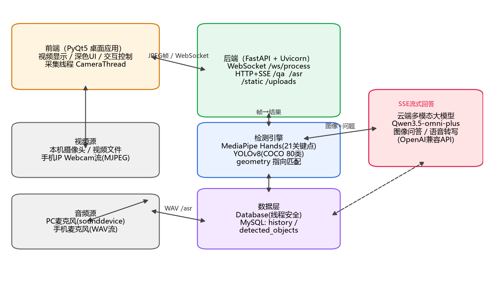
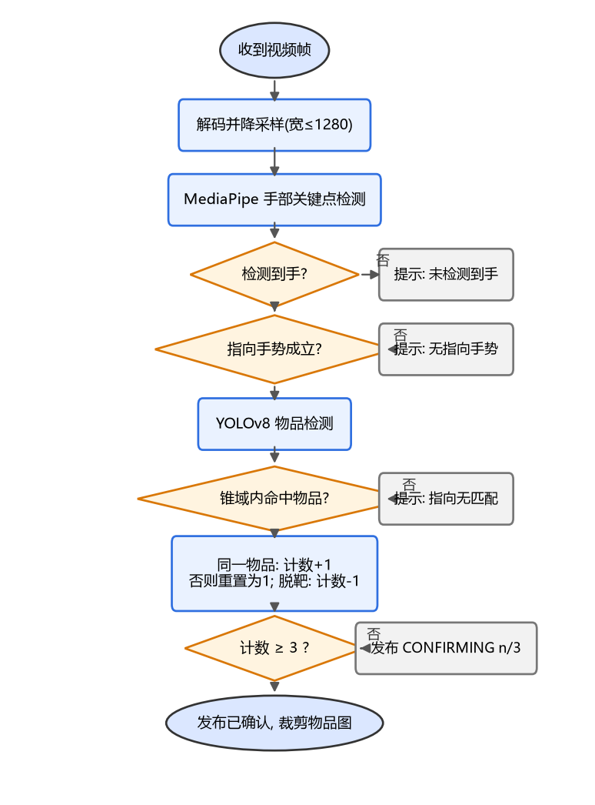
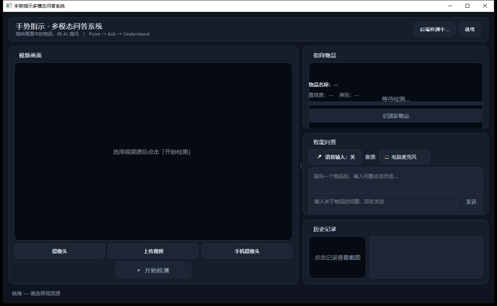
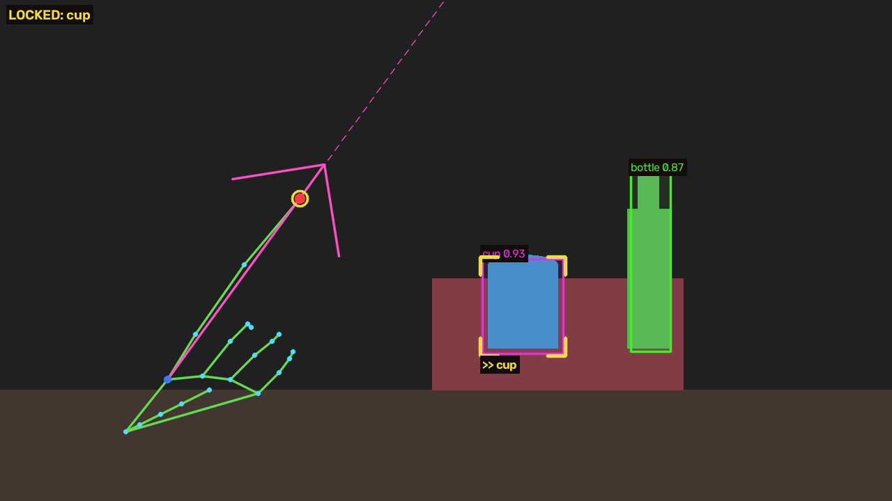

<!-- _class: lead -->

# 基于交互式手势指示与多模态融合的
# 实时物体识别问答系统

### 《计算机应用系统开发》课程设计答辩

汇报人：＿＿＿　　班级：计科 2023 级 5 班
指导教师：李俊延、蔡龙飞　　2026.10

> 讲稿（30s）：各位老师好。我们课题做的是一套"指哪问哪"的系统——用手指向摄像头画面里的物品，系统认出被指的物体，再用文字或语音向大模型提问，实时得到回答。

---

# 目录

1. 课题背景与痛点
2. 系统方案与总体架构
3. 核心技术
   - 指向手势识别
   - 锥域匹配 + 多帧确认
   - 多模态大模型问答
   - 双音源语音输入
4. 工程难点与解决
5. 系统演示与测试
6. 总结与展望

> 讲稿（20s）：汇报分六部分，重点讲第三、四部分——怎么把"指哪个"这件事算准，以及实时系统的工程处理。

---

# 一、课题背景与痛点

**场景**：面对陌生物品想知道"这是什么、怎么用、什么材质"

| 传统图像问答的痛点 | 我们的解法 |
|---|---|
| 拍照→上传→框选，链路冗长 | 摄像头常开，抬手指一下即可 |
| 说不清"是哪一个"（空间指代） | **手指指向 = 最自然的指代方式** |
| 打字提问慢 | 支持语音提问 |

**课题定位**：端侧感知（手势+检测） + 云侧认知（多模态大模型）的实时交互系统

> 讲稿（40s）：核心洞察是：人指东西这个动作本身就完成了"目标选择"，我们把它工程化——一个指向动作替代了拍照、上传、框选三步。

---

# 二、系统方案：指哪 → 问哪 → 答哪

| 步骤 | 用户做什么 | 系统做什么 |
|---|---|---|
| ① | 对准物品 | 实时抽帧：摄像头/视频/手机流 |
| ② | 食指指向 | 手部21关键点 + YOLOv8 物品检测 |
| ③ | 保持约0.3秒 | 锥域匹配 + 连续3帧确认 → 锁定 |
| ④ | 说话/打字提问 | 物品裁剪图+问题 → Qwen-omni |
| ⑤ | 看回答 | SSE 流式打字机输出，自动存历史 |

> 讲稿（40s）：整个流程用户只感知"指一下、问一句"，背后是五步流水线。下面看架构。

---

# 三、总体架构（三层）



- **PyQt5 桌面端**：采集 / 渲染 / 交互（QThread 多线程）
- **FastAPI 本地服务**：WebSocket 实时检测 + HTTP/SSE 问答
- **Qwen3.5-omni-plus 云端**：图像问答与语音转写（同一模型，两种能力）

> 讲稿（40s）：感知放本地保实时，认知放云端保效果。注意一个选型：语音转写不接单独 ASR，直接复用 omni 的音频输入，少一个服务少一份成本。

---

# 四、核心技术 ①：指向手势识别

**方案**：MediaPipe Hand Landmarker（Tasks API，VIDEO 跟踪模式）

**判定算法**——比值法，对掌向/尺度鲁棒：

```
每指比值 = dist(指尖, 腕) / dist(指根, 腕)
食指比值 > 1.4  →  伸直
其余三指 < 1.2  →  弯曲
成立 = 一伸三弯
```

- 输出 21 关键点 → 前端绘制完整手部骨架
- 关键点→腕部比值而非角度：侧掌、俯仰都不影响判定

> 讲稿（40s）：不用现成手势分类器而是自己写规则，因为指向本质是几何问题；比值法两行代码，可单测、可调阈值。

---

# 五、核心技术 ②：指哪问哪的"哪"怎么算



**锥域匹配**：前向投影 > 0 且夹角 ≤ 45° 才候选，
`score = 0.3×前向距离 + 垂直偏离` 取最优

**多帧确认**：同物品 +1 / 脱靶 −1 / 换物重置，
≥3 帧才锁定 → 指向空白**不误报**

> 讲稿（50s）：这是全系统最难的点。第一版用"最近物品兜底"，指空气也会锁定物品——典型的算法想当然。修复为锥域约束+时序确认，并把这块抽成零依赖纯函数，单测覆盖边界用例。

---

# 六、核心技术 ③④：多模态问答与语音输入

**图像问答**（/qa，SSE 流式）

```python
content = [ {"type":"image_url", ...物品裁剪图...},
            {"type":"text", "text": question} ]
```

**语音输入**（/asr，复用同一模型）

- 双音源：PC 麦克风（sounddevice）/ **手机麦克风**（IP Webcam /audio.wav 流）
- 录音 ≤15s → 转写 → **填入输入框可编辑**再发送
- 坑：omni 音频必须 data URL + 强制 stream 模式（实测定位）

> 讲稿（40s）：问答链路的关键体验是"打字机"流式；语音特意做成先转文字再发送——识别错了用户能改，比直接发出去体验可控。

---

# 七、工程难点与解决（亮点页）

| 问题现象 | 根因 | 解决 |
|---|---|---|
| 检测框与画面错位 | 前后端坐标系不一致 | 统一"处理帧推理→坐标换算回原帧" |
| 结果越用越延迟 | 帧排队堆积 | **latest-frame 单槽背压**，旧帧自动丢弃 |
| 手机流黑屏刷屏 | FFmpeg 解析畸形 multipart 失败 | 自研 JPEG SOI/EOI 扫帧 + 快速失败 |
| 8080 转发报 10013 | 本机端口被其他进程独占 | 多端口候选 + HTTP 探活自动降级 |
| 并发写库游标错乱 | pymysql 单连接跨线程共享 | 锁 + ping 重连封装 |

> 讲稿（60s）：这部分是课堂之外的真实收获——算法跑通只是起点，坐标一致性、背压、线程安全这些工程细节才决定系统能不能稳定用。（可挑一个展开讲）

---

# 八、系统演示

| 主界面（真实截图） | 指向确认效果 |
|---|---|
|  |  |

**现场演示流程**：手机摄像头作视频源 → 指向物品 → 确认锁定 → 语音提问 → 流式回答 → 历史回看

> 讲稿（30s）：界面为深色主题，状态徽章实时显示流水线阶段。接下来现场演示（或播放录屏）。

---

# 九、测试与质量保障

**功能测试**：9 项需求 × 标准化用例单，全部通过（见报告表 6.1–6.3）

**非功能指标实测**：

| 指标 | 要求 | 实测 |
|---|---|---|
| 显示帧率 | ≥10 FPS | 10 FPS 稳定，无积压 |
| 确认反馈延迟 | ≤0.5 s | 0.3–0.5 s |
| 语音转写(3s样本) | ≤10 s | **1.3 s** |
| 问答首 token | ≤3 s | ~1.5 s |

**白盒**：54 项单元测试（指向匹配/帧解析/坐标换算/地址纠错）全过，ruff 零告警

> 讲稿（40s）：测试是黑盒功能用例加白盒单元测试双轨。54 个单测全部无需摄像头和网络，能进 CI——这也是纯函数化设计带来的红利。

---

# 十、总结与展望

**完成情况** ✅

- 三层架构实时系统全部 9 项功能交付
- 指向消解算法（锥域+多帧确认）达到可用精度
- 双音源语音提问、历史持久化、全链路异常降级

**展望**

- TTS 语音播报 → 全语音闭环
- 开放词汇检测（YOLO-World）突破 COCO 80 类
- 手势词表扩展（握拳=清除、张掌=上一个）
- 模型量化端侧化，摆脱网络依赖

> 讲稿（30s）：课题达到了任务书全部要求。展望里最有价值的是开放词汇检测——目前系统只认 COCO 80 类，这是体验上限所在。

---

<!-- _class: lead -->

# 请各位老师批评指正

### 汇报完毕 · 谢谢聆听

现场可演示：指物问答 / 手机摄像头与手机麦克风音源切换

> 讲稿：结束语。手机、PC 均已连接就绪，可现场演示任意环节。
